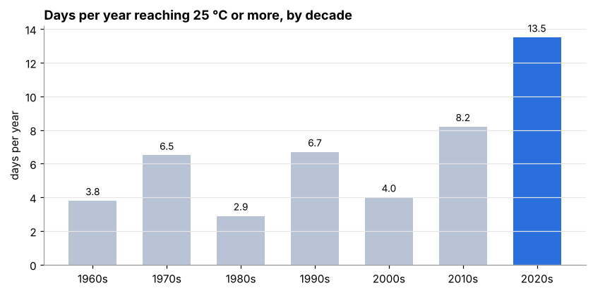
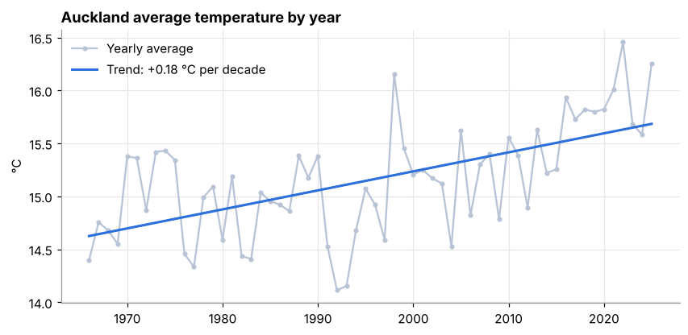

# 🌤️ Auckland Climate Analysis, 1966–2026

**Business question:** How has Auckland's climate changed over the last 60 years, and what should city planners, energy providers and businesses expect now?

[**Live dashboard**](https://auckland-weather-app.vercel.app) · [**Analysis notebook**](data/analysis.ipynb) · [**SQL queries**](sql/)

   

---

## Executive Summary

Analysis of **22,208 days** of Auckland weather shows:

1. **Auckland has warmed by about 1.1 °C since 1966** (+0.18 °C per decade, p < 0.001). 4 of the 5 warmest years have happened since 2016.
2. **Hot days (≥ 25 °C) have more than tripled**, from 3.8 a year in the 1960s to **13.5 a year in the 2020s**, almost all in December–March.
3. **Cold nights (≤ 5 °C) have fallen by two thirds**, from 13.8 to 4.7 a year.
4. **Rainfall shows no clear long-term trend** (p = 0.80). Year-to-year variation is far larger than any change.
5. **My original forecast model was no better than guessing.** Tested properly, it matched "always predict no rain" exactly. An improved model beats it, but only slightly beats "tomorrow = today".

<p align="center">
  
  
</p>

## Recommendations

1. **Plan for hot summers as the new normal.** Planning that assumes around 5 hot days a year (the 20th-century average) is out of date. The 2020s average is 13.5, which matters for cooling in schools, rest homes and rental housing, and for summer staffing and outdoor work.
2. **Businesses with summer-sensitive demand** (drinks, ice cream, fans, outdoor venues, electricity retailers) should plan stock and capacity around January–February, where hot days are now far more common.
3. **Don't use this kind of data for flood planning.** Gridded data smooths out extreme downpours: the record-breaking 27 January 2023 flood only ranks #7 here. Flood decisions need local rain-gauge data.
4. **For day-ahead decisions, use a real weather forecast.** Simple history-based models add little over "tomorrow will be like today".

---

## Dataset

| | |
|---|---|
| **Source** | [Open-Meteo](https://open-meteo.com/) historical weather API, ERA5 reanalysis, Auckland (−36.94, 174.78) |
| **Size** | 22,208 rows, one per day, 1 Jan 1966 – 20 Oct 2026 |
| **Columns** | daily max / min / mean temperature (°C), daily rainfall (mm) |
| **File** | [`data/auckland_daily_era5.csv`](data/auckland_daily_era5.csv), committed so every result can be reproduced |

ERA5 combines weather stations, satellites and weather balloons into a consistent grid with no gaps. That makes it reliable for long-term trends, but each grid cell covers tens of kilometres, so very local extremes are smoothed out.

## Data Cleaning & Quality Checks

Checked in both SQL ([`sql/02_data_quality.sql`](sql/02_data_quality.sql)) and Python ([notebook](data/analysis.ipynb), section 2):

| Check | Result |
|---|---|
| Missing values | 0 |
| Duplicate dates / gaps in the calendar | 0 / 0 |
| Min temp above max, or mean outside min–max | 0 |
| Negative or impossible rainfall | 0 |
| Incomplete years | **2026** (293 days), excluded from yearly totals so it doesn't look artificially dry |

## Tools

| Tool | Used for |
|---|---|
| **SQL (PostgreSQL)** | Table design with validation rules, data quality checks, yearly/decade aggregation, trends with `regr_slope`, window functions (`RANK`, `LAG`, `LEAD`) |
| **Python (pandas, SciPy)** | Cleaning, trend significance tests (linear regression p-values) |
| **scikit-learn** | Forecast models, time-based train/test split, baseline comparison |
| **matplotlib / Jupyter** | Charts and the written analysis |
| **Next.js, Recharts, Supabase** | Interactive dashboard and prediction game |
| **Vercel Cron** | Automated daily data updates |

## Model Evaluation: is the forecast any good?

Task: predict **tomorrow's** max temperature and whether it will rain (> 1 mm), using only today's information.
Trained on 1966–2015, **tested on 2016–2026** (3,945 unseen days), and compared against simple baselines.

| Tomorrow's high temperature | Average error (MAE) |
|---|---|
| Original model (day of year only) | ±1.47 °C |
| Baseline: same as today | ±1.06 °C |
| **Improved: day of year + today's weather** | **±1.00 °C** |

| Will it rain tomorrow? | Accuracy |
|---|---|
| Baseline: always "no rain" | 59.8% |
| Original model (day of year only) | 59.8% |
| Baseline: rain if it rained today | 66.6% |
| **Improved: day of year + today's weather** | **68.3%** |

**What I learned:** my original models reported R² = 0.76 and 66.2% accuracy, but those numbers were measured on the data the models were trained on, with nothing to compare against. Tested on unseen years, the rain model was no better than always guessing "no rain", and the temperature model was beaten by "tomorrow = today". A model is only useful if it beats a simple baseline.

## Methodology & Limitations

- **Trends** are straight-line regressions on yearly values (complete years only), with p-values to check they are not chance. Decade averages are shown because they are easier to read. The 1960s include 4 years and the 2020s 6 years.
- **Models** use seasonal (sin/cos day-of-year) features, plus today's temperature and rain in the improved version. Splitting by time, rather than randomly, stops the model from "seeing the future".
- **Limitations:** ERA5 is a grid, not a single station, so local extremes are underestimated. Climate cycles such as El Niño / La Niña drive year-to-year swings and are not modelled.
- **Next steps:** compare with NIWA Auckland Airport station data, and add El Niño / La Niña phases to explain year-to-year variation.

## Repository Files

| File | What it contains |
|---|---|
| [`data/analysis.ipynb`](data/analysis.ipynb) | **Start here.** Full analysis with explanations, charts and recommendations |
| [`sql/01_schema.sql`](sql/01_schema.sql) | Table design with validation rules |
| [`sql/02_data_quality.sql`](sql/02_data_quality.sql) | Data quality checks |
| [`sql/03_analysis.sql`](sql/03_analysis.sql) | Trend, decade, ranking and rain-persistence queries |
| [`data/analyze.py`](data/analyze.py) | Script that produces the JSON files used by the dashboard |
| [`src/`](src/) | Next.js dashboard and game |

---

## Dashboard & Game Features

### 📊 Analysis Dashboard

- **Key findings** — warming trend, hot days by decade, rainfall trend and data limitations
- **Model evaluation** — original vs improved model vs simple baselines, on held-out years
- **Live 30-day data** — fetched daily from the Open-Meteo ERA5 archive API (real observations, not predictions)
- **Human vs AI** — compare community prediction accuracy against the improved model
- **Interactive charts** (Recharts) — monthly temperature, 60-year trend, rainfall & rain probability

### 🎮 Daily Guess Game
- Predict tomorrow's Auckland maximum temperature (slider) and whether it will rain
- Results verified automatically the next day via Open-Meteo archive data — no manual input
- Personal accuracy stats vs the AI model: rain prediction % and average temperature error
- Leaderboard of top 10 players

**Scoring:**

| Condition | Points |
|-----------|--------|
| Temp within ±1°C | +20 |
| Temp within ±2°C | +10 |
| Temp within ±3°C | +5 |
| Rain prediction correct | +10 |
| Both correct (double hit) | +5 bonus |

### 🏆 Avatar Shop
- 9 weather-themed emoji avatars, from free to 2,000 pts
- Unlocked permanently with game points
- Active avatar shown on leaderboard

---

## Tech Stack

| Layer | Technology |
|-------|-----------|
| Frontend | Next.js 16 (App Router) · TypeScript · Tailwind CSS v4 |
| Charts | Recharts v3 |
| Data Analysis | Python · Pandas · SciPy · scikit-learn |
| Backend | Next.js API Routes · Supabase (PostgreSQL) |
| Weather API | Open-Meteo — forecast + ERA5 archive (free, no API key) |
| Automation | Vercel Cron Jobs — daily auto-verification at 1 AM NZT |
| Deployment | Vercel (ISR, revalidates hourly) |

---

## Getting Started

### Prerequisites
- Node.js 18+
- Python 3.10+ with pandas, scipy and scikit-learn

### 1. Clone the repository
```bash
git clone https://github.com/Gina-26/auckland-weather-app.git
cd auckland-weather-app
```

### 2. Run the Python data analysis (first time only)
```bash
pip install -r data/requirements.txt
python data/analyze.py
# Reads data/auckland_daily_era5.csv and writes 6 JSON files to public/data/
```

### 3. Configure environment variables
```bash
cp .env.local.example .env.local
# Fill in your Supabase credentials
```

### 4. Set up Supabase
1. Create a project at [app.supabase.com](https://app.supabase.com)
2. Run `supabase/schema.sql` in the SQL Editor
3. Copy your project URL and anon key into `.env.local`

### 5. Install dependencies and run
```bash
npm install
npm run dev
# Open http://localhost:3000
```

---

## Dashboard Data Pipeline

**Source:** [Open-Meteo](https://open-meteo.com/) ERA5 reanalysis for Auckland (−36.94, 174.78), daily from 1966-01-01.
The raw CSV is committed at `data/auckland_daily_era5.csv`, so every number on the site can be reproduced with one command.
(If the original NIWA station CSVs are placed one directory above the project root, `analyze.py` uses those instead.)

**Generated JSON files** (produced by `data/analyze.py`):

```
public/data/
├── findings.json          # Trends, decade summaries, warmest years, wettest days
├── evaluation.json        # Model vs baseline results on held-out years
├── stats.json             # Summary statistics
├── monthly_averages.json  # Monthly averages + seasonal predictions
├── yearly_trends.json     # Annual average trends
└── model.json             # Improved model metrics (used by the game)
```

**Live data pipeline:**

- Recent 30-day chart fetches from Open-Meteo ERA5 archive (real observations)
- Game scoring uses the same archive API — never forecast/predicted data
- Vercel Cron runs at 13:00 UTC daily (≈ 1 AM NZT) to verify all pending guesses

## Deployment

```bash
npm install -g vercel
vercel --prod
```

Set the following environment variables in the Vercel dashboard:

| Variable | Description |
|----------|-------------|
| `NEXT_PUBLIC_SUPABASE_URL` | Your Supabase project URL |
| `NEXT_PUBLIC_SUPABASE_ANON_KEY` | Supabase anon/public key |
| `SUPABASE_SERVICE_ROLE_KEY` | Supabase service role key (optional, falls back to anon) |

---

## Project Structure

```
auckland-weather-app/
├── data/
│   ├── analysis.ipynb          # Full written analysis (start here)
│   ├── analyze.py              # Python analysis, trend tests + model evaluation
│   ├── auckland_daily_era5.csv # Raw daily data (1966–2026)
│   └── requirements.txt
├── sql/                        # Schema, data quality checks, analysis queries
├── docs/                       # Charts used in this README
├── public/data/                # Pre-generated JSON (committed)
├── src/
│   ├── app/
│   │   ├── page.tsx            # Analysis dashboard (ISR, revalidates hourly)
│   │   ├── game/page.tsx       # Daily Guess game
│   │   ├── shop/page.tsx       # Avatar shop
│   │   └── api/
│   │       ├── weather/        # Open-Meteo forecast endpoint
│   │       ├── game/           # Profile, guess, verify, leaderboard, stats, shop
│   │       └── cron/verify/    # Automated daily verification (Vercel Cron)
│   ├── components/
│   │   ├── analysis/           # KeyFindings, ModelEvaluation
│   │   ├── charts/             # Recharts components (seasonal, yearly, rainfall, recent, hot days)
│   │   ├── game/               # GuessForm, ResultCard, Leaderboard
│   │   └── ui/                 # Navbar, StatCard
│   ├── lib/
│   │   ├── supabase.ts         # Supabase client
│   │   └── openmeteo.ts        # Open-Meteo API wrapper
│   └── types/index.ts
├── supabase/schema.sql         # Database DDL + avatar seed data
└── vercel.json                 # Cron job schedule
```

---

## License

MIT
